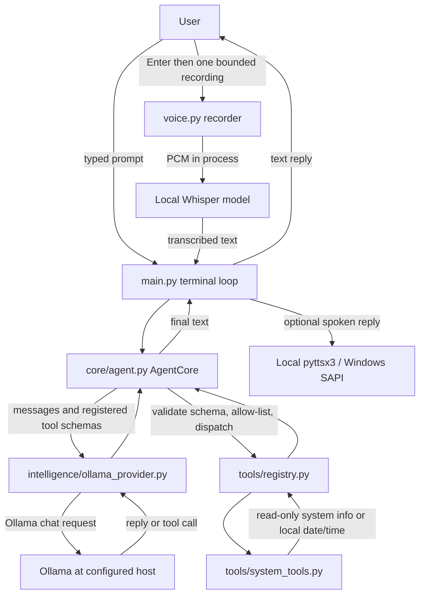

# ULTRON — Hack Days 2026

ULTRON is a Python terminal assistant that uses an Ollama-hosted local language model and a small, explicitly registered set of local tools. It supports text chat by default and an optional, bounded push-to-talk voice mode.

> **Project status:** this is a hackathon prototype. The implemented laptop tools only read basic system information and the local date/time. ULTRON does not currently provide general laptop control.

## Problem and goal

The project explores a local-first assistant that can answer conversational requests and use narrowly scoped tools. The goal is to keep model interaction separate from tool policy so model output is validated and authorized before a registered handler can run.

## Current features

- Synchronous terminal chat with `/exit`, `/quit`, or `/q` to leave.
- Conversation context retained in memory for the current process (bounded by the agent core).
- Ollama chat and function/tool-call adaptation; defaults to `qwen3:4b` at `http://localhost:11434`.
- Two registered, read-only tools: `get_system_info` and `get_datetime`.
- Optional push-to-talk: press Enter to record one utterance, transcribe it locally with Whisper via `pywhispercpp`, send the resulting text to the configured Ollama model, and speak the reply with `pyttsx3`/Windows SAPI.
- Voice dependencies load only when `--voice` is selected. Voice startup or device errors fall back to terminal chat.
- Unit tests use fakes and do not require a running Ollama service, microphone, or speakers.

## Architecture and data flow



`config.py` reads `OLLAMA_HOST` and `OLLAMA_MODEL` from process environment variables. `main.py` wires the provider, agent core, tool registry, and optional voice adapters. The agent core owns conversation state, step/tool-call limits, argument validation and authorization interfaces; the registry contains only explicitly registered handlers. The current command-line host does not provide an approval UI.

## Technology stack

- Python 3.10 or newer.
- Ollama Python client (`ollama`, declared in `requirements.txt`) and an Ollama server/model.
- Optional voice packages from `requirements-voice.txt`: `pywhispercpp`, `sounddevice`, and `pyttsx3`.
- `unittest` test cases; `pytest` is not required by the project.

## Setup on Windows

Open PowerShell in the project directory:

```powershell
cd "$HOME\OneDrive\Desktop\ULTRON-HACKDAYS-2026"
py -3 -m venv .venv
.\.venv\Scripts\python.exe -m pip install --upgrade pip
.\.venv\Scripts\python.exe -m pip install -r requirements.txt
```

Install and start [Ollama](https://ollama.com/), then download the default model:

```powershell
ollama pull qwen3:4b
```

The defaults are `OLLAMA_HOST=http://localhost:11434` and `OLLAMA_MODEL=qwen3:4b`. To use a different Ollama endpoint or installed model in the current PowerShell session, set environment variables before running ULTRON:

```powershell
$env:OLLAMA_HOST = "http://localhost:11434"
$env:OLLAMA_MODEL = "qwen3:4b"
```

The application reads these process environment variables; it does not load `.env` files. Keep any credentials or private endpoint details out of source control.

## Run

Text mode (the default):

```powershell
.\.venv\Scripts\python.exe main.py
```

Optional push-to-talk mode:

```powershell
.\.venv\Scripts\python.exe -m pip install -r requirements-voice.txt
.\.venv\Scripts\python.exe main.py --voice
```

Voice mode prompts before every capture. Press Enter to record one utterance (8 seconds by default; maximum 30 seconds), or enter `/exit` to quit. The default speech model name is `tiny.en`; the speech library may need to download that model on first use. To point at a local Whisper model file or choose another model name:

```powershell
.\.venv\Scripts\python.exe main.py --voice --whisper-model "C:\path\to\ggml-model.bin"
.\.venv\Scripts\python.exe main.py --voice --record-seconds 12
```

Voice recognition is configured for English. Actual device availability and speech quality depend on the computer's microphone, audio drivers, installed packages and model.

## Tool safety and authorization

- The model can request only tools exposed by the current registry. Tool arguments are checked against each tool's JSON schema, and the authorizer checks the registered tool allow-list before dispatch.
- The shipped tools only read system/CPU/memory information and local date/time. They do not change files, settings, applications or other computer state.
- The core includes a host-confirmation protocol for tools marked as requiring confirmation, but `main.py` supplies an authenticator that rejects such approvals, and no confirmation prompt is wired into this CLI. The two shipped read-only tools do not require confirmation. Adding a state-changing tool requires a deliberate host approval flow; model text alone is not approval.
- The core also bounds model steps, tool calls, pending confirmations and conversation history. These controls do not make arbitrary future tools safe by themselves; each new tool needs its own narrow schema and policy.

## Privacy and limitations

- Text prompts, conversation context for the active session, and tool results are sent to the Ollama server selected by `OLLAMA_HOST`. With the default local host this is the local Ollama service; setting a remote host sends that data to the remote service. Review the provider and model you use.
- Voice capture starts only after the Enter prompt. Each recording is bounded, held in memory for transcription, and is not intentionally uploaded as audio by this application. Transcribed text then follows the same Ollama path as typed text.
- Whisper recognition and speech playback run locally through the selected packages. A named Whisper model may be downloaded the first time it is loaded; use a local model path and prepare it in advance when offline operation is required.
- Conversation history is held in process memory and is not saved as permanent memory by this application. Audio files and transcripts are not intentionally written to disk by the current flow.
- This is a prototype, not a security boundary for a multi-user or untrusted-host environment. Local dependencies, the Ollama server, the chosen model, and the operating system remain part of the trust boundary.

## Tests

Run the regular offline suite from the project root:

```powershell
.\.venv\Scripts\python.exe -m unittest discover -s tests -v
```

`tests/test_ollama_integration.py` contains an opt-in integration test for a real local Ollama server and the `qwen3:4b` model. Install the model and ensure Ollama is running, then opt in explicitly:

```powershell
ollama pull qwen3:4b
$env:ULTRON_RUN_OLLAMA_INTEGRATION = "1"
.\.venv\Scripts\python.exe -m unittest discover -s tests -p "test_ollama_integration.py" -v
Remove-Item Env:ULTRON_RUN_OLLAMA_INTEGRATION
```

The integration test sends a harmless compatibility probe to the configured Ollama service. It skips when the opt-in variable is absent, Ollama is unavailable, or `qwen3:4b` is not installed. The standard test suite can therefore report this integration test as skipped; that does not indicate a failure.

## Troubleshooting

- **Model request failed / connection refused:** start Ollama, check `OLLAMA_HOST`, and run `ollama list` to confirm the configured model is installed. Pull it with `ollama pull qwen3:4b` if needed.
- **A different model is installed:** set `$env:OLLAMA_MODEL` to its exact Ollama model name before launch.
- **Voice packages missing:** install `requirements-voice.txt` into the same `.venv` used to run `main.py`.
- **Whisper model cannot load:** check the model name/path and allow its first-use download, or provide a valid local model path.
- **Microphone capture fails:** check Windows microphone permission, the selected input device, and audio drivers. The app falls back to terminal mode if voice becomes unavailable.
- **No spoken response:** check the Windows output device and SAPI voice support. Text responses remain available, and the app falls back to terminal mode if playback fails.
- **Python launcher unavailable:** install Python 3.10+ and create the virtual environment with the installed interpreter, for example `python -m venv .venv`.

## Development and contributions

Keep provider, orchestration, policy, tool handlers, and user interfaces separated. New tools should be explicitly registered, expose the smallest needed JSON schema, validate all inputs, and default to read-only behavior. For any state-changing capability, add a host-controlled approval flow before enabling it in the CLI. Add unit tests with fakes for behavior that must not require Ollama or hardware; keep real-service tests opt-in. Do not commit `.env` files, credentials, virtual environments, downloaded models or recordings; `.gitignore` already excludes these categories.

## AI tools, models and libraries disclosure

- **Assistant model runtime:** Ollama, using `qwen3:4b` by default. This model is not bundled and must be obtained separately through Ollama.
- **Voice model:** Whisper through `pywhispercpp`, default model name `tiny.en`; this is optional and not bundled.
- **Speech I/O libraries:** `sounddevice` for microphone capture and `pyttsx3` using Windows SAPI for local speech output.
- **Python integration library:** the `ollama` package connects to the configured Ollama server.
- **Development assistance:** disclose any generative AI tools or models used to write or revise this project's code, tests, documentation, designs or other submission material, along with their role, according to the hackathon's rules. No claim about additional development tools is made here.

## Roadmap (planned, not implemented)

- Wake-word activation such as “Hey ULTRON”.
- Graphical user interface.
- Permanent or cross-session memory.
- Expanded laptop control, including any state-changing actions. Such tools need narrow permissions and an explicit host approval experience before implementation.
